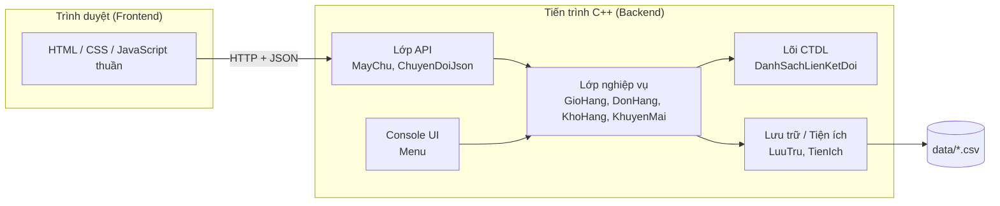

# 🛒 GioHangOnline — Hệ thống quản lý giỏ hàng trực tuyến

> Bài tập dự án nhóm cuối kì — **Cấu trúc dữ liệu và giải thuật (C++)** · Đề tài 2
> Giỏ hàng được cài đặt bằng **danh sách liên kết đôi tự viết**, có giao diện console và giao diện web (Frontend + Backend).

   

---

## Mục lục

1. [Giới thiệu](#1-giới-thiệu)
2. [Tính năng](#2-tính-năng)
3. [Kiến trúc hệ thống](#3-kiến-trúc-hệ-thống)
4. [Cấu trúc thư mục](#4-cấu-trúc-thư-mục)
5. [Yêu cầu môi trường](#5-yêu-cầu-môi-trường)
6. [Build và chạy](#6-build-và-chạy)
7. [Tài liệu API](#7-tài-liệu-api)
8. [Frontend](#8-frontend)
9. [Quy ước code](#9-quy-ước-code)
10. [Kiểm thử và chất lượng](#10-kiểm-thử-và-chất-lượng)
11. [Độ phức tạp thuật toán](#11-độ-phức-tạp-thuật-toán)
12. [Quy trình làm việc nhóm](#12-quy-trình-làm-việc-nhóm)
13. [Lộ trình](#13-lộ-trình)
14. [Tiêu chí hoàn thành (Definition of Done)](#14-tiêu-chí-hoàn-thành-definition-of-done)
15. [Thành viên và phân công](#15-thành-viên-và-phân-công)
16. [Minh bạch việc dùng AI](#16-minh-bạch-việc-dùng-ai)
17. [Xử lý sự cố thường gặp](#17-xử-lý-sự-cố-thường-gặp)
18. [Giấy phép và ghi nhận](#18-giấy-phép-và-ghi-nhận)

---

## 1. Giới thiệu

**GioHangOnline** mô phỏng phần lõi của giỏ hàng một cửa hàng trực tuyến: người dùng thêm, xem, sửa, xóa mặt hàng và tạo đơn hàng từ giỏ.

Điểm cốt lõi của đề tài không nằm ở giao diện mà ở **cấu trúc dữ liệu**: giỏ hàng là một **danh sách liên kết đôi (Doubly Linked List) tự cài đặt**, mỗi node lưu một mặt hàng và hai con trỏ `truoc` / `sau`.

Mục tiêu của dự án:

| # | Mục tiêu | Cách chứng minh |
|---|----------|-----------------|
| 1 | Cài đúng danh sách liên kết đôi, không rò rỉ bộ nhớ | Bộ test + AddressSanitizer/Valgrind |
| 2 | Giải thích được vì sao chọn cấu trúc này | Bảng độ phức tạp + benchmark (mục 11) |
| 3 | Kiểm thử có hệ thống | 23 test case TC01–TC23 (mục 10) |
| 4 | Mỗi thành viên giải thích được code của mình | Hỏi đáp chéo hằng tuần, nhật ký AI |
| 5 | Sản phẩm demo thao tác được | Console ổn định + giao diện web |

> **Lưu ý phạm vi:** giao diện không phải tiêu chí chấm chính. Console là bản demo bắt buộc và là phương án dự phòng; web chỉ được tích hợp sau khi lõi và nghiệp vụ đã đạt kiểm thử (xem [mục 13](#13-lộ-trình)).

---

## 2. Tính năng

### 2.1 Chức năng bắt buộc theo đề

| Mã | Chức năng | Quy tắc chính | Trạng thái |
|----|-----------|---------------|:----------:|
| F1 | Thêm mặt hàng vào giỏ | Hợp lệ: mã không rỗng, giá > 0, số lượng ≥ 1; trùng mã thì cộng dồn số lượng | ⬜ |
| F2 | Xem giỏ hàng | Bảng STT/mã/tên/đơn giá/số lượng/thành tiền; tổng số lượng; tổng tiền (64-bit); xem xuôi và ngược | ⬜ |
| F3a | Sửa mặt hàng | Sửa tên/giá/số lượng; không sửa mã; giá trị sai thì giữ nguyên | ⬜ |
| F3b | Xóa mặt hàng | Xử lý 4 trường hợp: node duy nhất / đầu / cuối / giữa; giải phóng bộ nhớ | ⬜ |
| F4 | Tạo đơn hàng | Từ chối giỏ rỗng; đơn là bản sao sâu; chỉ làm rỗng giỏ sau khi tạo đơn thành công | ⬜ |

### 2.2 Tính năng mở rộng (theo mức ưu tiên)

| Mức | Tính năng | Trạng thái |
|-----|-----------|:----------:|
| Nên làm | Lưu/đọc giỏ và đơn bằng CSV · Kho sản phẩm mẫu (≥ 30 dòng) · Chế độ **Xem cấu trúc** (in node và con trỏ) | ⬜ |
| Nâng cao (chọn 2–3) | Mã giảm giá + phí vận chuyển · Sắp xếp giỏ (Bubble → Merge Sort) · Undo/Redo bằng Stack tự cài · Lịch sử đơn và thống kê | ⬜ |
| Tối ưu (bắt buộc 1) | Chỉ mục bảng băm `maHang → Nut*` · Benchmark n = 1.000 / 10.000 / 100.000 | ⬜ |
| Dài hạn | Nhiều người dùng · SQLite/MySQL · Docker | ⬜ |

*(Cập nhật ô trạng thái: ⬜ chưa làm · 🟨 đang làm · ✅ xong và đã qua test.)*

---

## 3. Kiến trúc hệ thống

### 3.1 Sơ đồ tổng thể



### 3.2 Nguyên tắc kiến trúc

1. **Phụ thuộc một chiều:** lớp dưới không gọi lớp trên. Lõi và nghiệp vụ **không dùng `cin`/`cout`**; chúng trả về mã kết quả `KetQua`.
2. **Hai "adapter" dùng chung nghiệp vụ:** Console (`Menu`) và Web (`MayChu`) cùng gọi `GioHang`/`DonHang`, nên đổi giao diện không phải sửa lõi.
3. **Một nguồn sự thật:** trạng thái giỏ hàng nằm ở server. Frontend chỉ hiển thị; sau mỗi thao tác nó tải lại dữ liệu từ API.
4. **Một tên – một nghĩa:** cùng một khái niệm dùng cùng một tên ở C++, JSON, JavaScript và CSV (ví dụ `maHang`).
5. **Đóng băng hợp đồng giao diện:** các file `.h` được chốt ở Giai đoạn 0; muốn đổi chữ ký hàm phải qua quy trình ở [mục 9.5](#95-quy-trình-thay-đổi-header).

---

## 4. Cấu trúc thư mục

```text
GioHangOnline/
├── CMakeLists.txt
├── README.md
├── .gitignore                    # build/, *.exe, *.o, logs/
├── data/
│   ├── san_pham_mau.csv          # kho mẫu, >= 30 dòng
│   ├── gio_hang.csv              # tự sinh khi lưu
│   └── don_hang.csv
├── docs/
│   ├── quyet_dinh_thiet_ke.md    # các điểm "cần quy ước" đã chốt
│   ├── quy_uoc_api.md            # hợp đồng API (đóng băng GĐ0)
│   ├── nhat_ky_AI.md
│   ├── bang_test_case.xlsx
│   └── bao_cao.pdf
├── include/                      # file .h = hợp đồng giao diện
│   ├── KetQua.h                  # enum KetQua + thongBaoTuKetQua()
│   ├── QuyDinh.h                 # hằng số + hàm kiểm tra hợp lệ dùng chung
│   ├── MatHang.h
│   ├── DanhSachLienKetDoi.h
│   ├── GioHang.h
│   ├── DonHang.h                 # DonHang + QuanLyDonHang
│   ├── KhoHang.h
│   ├── KhuyenMai.h
│   ├── NganXep.h                 # Stack cho Undo/Redo
│   ├── LuuTru.h
│   ├── TienIch.h
│   ├── Menu.h
│   └── api/
│       ├── MayChu.h              # khởi tạo server, đăng ký route
│       └── ChuyenDoiJson.h      # MatHang/DonHang <-> JSON
├── src/                          # file .cpp tương ứng
│   ├── main.cpp                  # entry point console
│   ├── main_web.cpp              # entry point web server
│   └── api/
├── tests/
│   ├── kiem_tra.h                # mini framework test
│   └── test_*.cpp
├── benchmark/
│   └── do_hieu_nang.cpp
├── third_party/                  # httplib.h, json.hpp (ghi rõ phiên bản)
│   └── README.md
└── web/                          # Frontend
    ├── index.html
    ├── css/style.css
    ├── js/
    │   ├── cauHinh.js
    │   ├── apiKhach.js
    │   ├── tienIch.js
    │   ├── giaoDien.js
    │   └── main.js
    └── mock/                     # JSON giả để làm UI khi backend chưa xong
```

---

## 5. Yêu cầu môi trường

| Thành phần | Yêu cầu |
|------------|---------|
| Trình biên dịch | `g++` ≥ 9 (MinGW-w64/MSYS2 trên Windows, hoặc g++ trên Linux/WSL) hoặc MSVC 2019+, chuẩn **C++17** |
| Build | CMake ≥ 3.16 (dự phòng: lệnh `g++` trực tiếp) |
| Git | Git + tài khoản GitHub |
| Trình duyệt | Chrome hoặc Edge bản mới (dùng DevTools để gỡ lỗi Frontend) |
| Công cụ gọi API | `curl` hoặc Postman |
| Kiểm tra bộ nhớ | AddressSanitizer (`-fsanitize=address`) hoặc Valgrind (Linux/WSL) |
| Soạn thảo | VS Code (C/C++, CMake Tools) hoặc CLion |

**Thư viện bên thứ ba** (chỉ một file header mỗi thư viện, đặt trong `third_party/`):

- [`cpp-httplib`](https://github.com/yhirose/cpp-httplib) — HTTP server.
- [`nlohmann/json`](https://github.com/nlohmann/json) — đọc/ghi JSON.

> Ghi rõ **số phiên bản** đã dùng vào `third_party/README.md` để mọi người dùng cùng một bản.

**Cả nhóm phải dùng cùng một loại trình biên dịch và cùng chuẩn C++17** để tránh lỗi "máy tôi chạy được".

---

## 6. Build và chạy

> Các lệnh dưới đây là **mẫu chuẩn của dự án**; hãy chạy thử trên máy mình ngay ở Giai đoạn 0 và sửa README nếu có khác biệt.

### 6.1 Clone và build bằng CMake

```bash
git clone <URL-repo>
cd GioHangOnline
cmake -S . -B build -DCMAKE_BUILD_TYPE=Release
cmake --build build
```

Kết quả:

| File chạy | Chức năng |
|-----------|-----------|
| `gio_hang` | Ứng dụng console |
| `gio_hang_web` | Web server (API + phục vụ thư mục `web/`) |
| `chay_test` | Chạy toàn bộ test tự động |
| `do_hieu_nang` | Benchmark |

### 6.2 Chạy console

```bash
./build/gio_hang
```

### 6.3 Chạy web

```bash
./build/gio_hang_web --port 8080 --web web --data data
```

Mở trình duyệt: <http://127.0.0.1:8080>

Tham số:

| Tham số | Mặc định | Ý nghĩa |
|---------|----------|---------|
| `--port` | `8080` | Cổng lắng nghe |
| `--web` | `web` | Thư mục chứa giao diện |
| `--data` | `data` | Thư mục chứa file CSV |

Server mặc định chỉ lắng nghe `127.0.0.1` (không mở ra mạng ngoài).

### 6.4 Chạy test và kiểm tra bộ nhớ

```bash
./build/chay_test                # kỳ vọng: "Dat X / X test"
```

Kiểm tra rò rỉ bộ nhớ (Linux/WSL):

```bash
cmake -S . -B build_asan -DCMAKE_BUILD_TYPE=Debug \
      -DCMAKE_CXX_FLAGS="-fsanitize=address -g"
cmake --build build_asan
./build_asan/chay_test
```

### 6.5 Phương án dự phòng (không cần CMake)

```bash
g++ -std=c++17 -Wall -Wextra -Iinclude -Ithird_party src/*.cpp -o gio_hang   # chỉnh danh sách file cho đúng
```

### 6.6 Đo hiệu năng

```bash
./build/do_hieu_nang        # luôn chạy bản Release (-O2)
```

---

## 7. Tài liệu API

Địa chỉ gốc: `http://127.0.0.1:8080/api` · Định dạng: JSON, mã hóa UTF-8.

### 7.1 Khuôn phản hồi chung

Mọi phản hồi (kể cả lỗi) đều có dạng:

```json
{
  "thanhCong": true,
  "maKetQua": "THANH_CONG",
  "thongBao": "Đã thêm mặt hàng vào giỏ.",
  "duLieu": {}
}
```

`maKetQua` chính là tên enum `KetQua` ở backend; frontend dựa vào đó để xử lý, không dựa vào nội dung `thongBao`.

### 7.2 Danh sách endpoint

| Phương thức | Đường dẫn | Mô tả | Mã HTTP thành công |
|-------------|-----------|-------|:------------------:|
| GET | `/api/suc-khoe` | Kiểm tra server sống | 200 |
| GET | `/api/gio` | Lấy giỏ hàng + tổng | 200 |
| POST | `/api/gio` | Thêm mặt hàng (trùng mã thì cộng dồn) | 201 / 200 |
| PUT | `/api/gio/{ma}` | Sửa tên / giá / số lượng | 200 |
| DELETE | `/api/gio/{ma}` | Xóa một mặt hàng | 200 |
| DELETE | `/api/gio` | Xóa toàn bộ giỏ | 200 |
| GET | `/api/cau-truc` | Chế độ Xem cấu trúc (node + con trỏ) | 200 |
| GET | `/api/kho` | Danh sách kho (`?tuKhoa=` để tìm) | 200 |
| POST | `/api/don` | Tạo đơn từ giỏ | 201 |
| GET | `/api/don` | Lịch sử đơn | 200 |
| GET | `/api/don/{maDon}` | Chi tiết một đơn | 200 |

### 7.3 Ánh xạ `KetQua` → mã HTTP

| `maKetQua` | HTTP | Khi nào |
|------------|:----:|---------|
| `THANH_CONG` | 200/201 | Thành công |
| `THANH_CONG_CONG_DON` | 200 | Thêm trùng mã, số lượng được cộng dồn |
| `MA_KHONG_HOP_LE` | 400 | Mã rỗng, có khoảng trắng, quá dài |
| `TEN_KHONG_HOP_LE` | 400 | Tên rỗng hoặc quá dài |
| `GIA_KHONG_HOP_LE` | 400 | Giá ≤ 0 hoặc vượt giới hạn |
| `SO_LUONG_KHONG_HOP_LE` | 400 | Số lượng < 1 hoặc vượt giới hạn |
| `YEU_CAU_KHONG_HOP_LE` | 400 | JSON sai cú pháp / thiếu trường |
| `KHONG_TIM_THAY` | 404 | Mã mặt hàng hoặc mã đơn không tồn tại |
| `GIO_RONG` | 409 | Tạo đơn khi giỏ rỗng |
| `VUOT_TON_KHO` | 409 | Số lượng vượt tồn kho |
| `LOI_FILE` | 500 | Không đọc/ghi được file |

### 7.4 Ví dụ

**Thêm mặt hàng**

```bash
curl -X POST http://127.0.0.1:8080/api/gio \
     -H "Content-Type: application/json" \
     -d '{"maHang":"SP001","tenHang":"Chuot khong day","donGia":250000,"soLuong":2}'
```

```json
{
  "thanhCong": true,
  "maKetQua": "THANH_CONG",
  "thongBao": "Đã thêm mặt hàng vào giỏ.",
  "duLieu": {
    "matHang": { "maHang": "SP001", "tenHang": "Chuot khong day", "donGia": 250000, "soLuong": 2, "thanhTien": 500000 },
    "daCongDon": false
  }
}
```

**Lấy giỏ hàng**

```json
{
  "thanhCong": true,
  "maKetQua": "THANH_CONG",
  "thongBao": "",
  "duLieu": {
    "danhSachMatHang": [
      { "stt": 1, "maHang": "SP001", "tenHang": "Chuot khong day", "donGia": 250000, "soLuong": 2, "thanhTien": 500000 }
    ],
    "soMatHang": 1,
    "tongSoLuong": 2,
    "tongTien": 500000
  }
}
```

**Lỗi dữ liệu**

```json
{
  "thanhCong": false,
  "maKetQua": "SO_LUONG_KHONG_HOP_LE",
  "thongBao": "Số lượng phải từ 1 trở lên.",
  "duLieu": null
}
```

**Xem cấu trúc**

```json
{
  "duLieu": {
    "dau": "SP001", "cuoi": "SP003", "soNut": 3,
    "cacNut": [
      { "viTri": 0, "maHang": "SP001", "truoc": null,    "sau": "SP002" },
      { "viTri": 1, "maHang": "SP002", "truoc": "SP001", "sau": "SP003" },
      { "viTri": 2, "maHang": "SP003", "truoc": "SP002", "sau": null }
    ]
  }
}
```

### 7.5 Quy tắc phía server

- **Server luôn kiểm tra lại dữ liệu**, không tin client.
- Mọi handler khóa `std::mutex` khi đọc/ghi giỏ (server xử lý nhiều luồng).
- Giới hạn kích thước body request; JSON sai cú pháp trả `400`, không làm sập server.
- Ghi file CSV theo kiểu **ghi file tạm rồi đổi tên** để không hỏng dữ liệu khi lỗi giữa chừng.
- Ghi nhật ký mỗi request vào `logs/server.log` (thời điểm, phương thức, đường dẫn, mã HTTP).

> Hợp đồng chi tiết nằm ở `docs/quy_uoc_api.md`. Mọi thay đổi API phải sửa file này trong cùng Pull Request.

---

## 8. Frontend

### 8.1 Công nghệ

**HTML5 + CSS3 + JavaScript (ES6) thuần**, không framework, không bước build. Server C++ phục vụ trực tiếp thư mục `web/`, nên không cần Node.js và không gặp vấn đề CORS (cùng nguồn gốc).

React/Vite hoặc Qt dành cho giai đoạn dài hạn (v4.0), không làm trong học phần này.

### 8.2 Màn hình

| Màn hình | Nội dung |
|----------|----------|
| Kho sản phẩm | Lưới thẻ sản phẩm, ô chọn số lượng, nút **Thêm vào giỏ**, ô tìm kiếm |
| Giỏ hàng | Bảng STT/mã/tên/đơn giá/số lượng (+/−)/thành tiền/xóa; tổng số lượng; tổng tiền; nút **Xóa tất cả**, **Tạo đơn** |
| Thêm thủ công | Form nhập mã, tên, giá, số lượng (đúng yêu cầu F1) |
| Xem cấu trúc | Sơ đồ `dau ⇄ node ⇄ node ⇄ cuoi` vẽ từ `/api/cau-truc` — dùng khi vấn đáp |
| Đơn hàng | Lịch sử đơn, xem chi tiết |
| Thông báo | Toast thành công/lỗi; trạng thái rỗng, đang tải, mất kết nối |

### 8.3 Quy tắc bắt buộc

1. **Server là nguồn sự thật:** sau mỗi thao tác thay đổi, gọi lại `layGioHang()` rồi vẽ lại. Không tự cộng tổng tiền ở client.
2. **Kiểm tra ở client chỉ để trải nghiệm tốt hơn**; kiểm tra thật nằm ở server.
3. **Chống XSS:** hiển thị tên hàng bằng `textContent`, không gán `innerHTML` với dữ liệu người dùng.
4. Xử lý theo `maKetQua`, không so sánh chuỗi `thongBao`.
5. Mọi lời gọi API đi qua `apiKhach.js`; các file khác không tự `fetch`.
6. Tiền hiển thị dạng `1.250.000 đ` (dùng `Intl.NumberFormat('vi-VN')`).

### 8.4 Quy trình làm Frontend

1. Vẽ wireframe (giấy, draw.io hoặc Figma) và chốt `docs/quy_uoc_api.md`.
2. Dựng giao diện bằng dữ liệu giả trong `web/mock/` (không cần chờ backend).
3. Thay mock bằng API thật khi endpoint tương ứng đã qua test.
4. Kiểm thử bằng checklist (mục 10.4) và tab **Network** của DevTools.

---

## 9. Quy ước code

> Mục tiêu: mọi thành viên khai báo **trùng khớp** để không lỗi biên dịch/liên kết và dễ đọc code của nhau.

### 9.1 Quy tắc đặt tên

| Đối tượng | Quy tắc | Ví dụ |
|-----------|---------|-------|
| Ngôn ngữ đặt tên | Tiếng Việt **không dấu** | `maHang`, `themCuoi` |
| File / lớp / struct | `PascalCase`, tên file trùng tên lớp | `GioHang.h`, `class GioHang` |
| Hàm, biến, tham số, thành viên | `camelCase` | `tongTien`, `soLuongMoi` |
| Hằng, enum, macro | `IN_HOA_GACH_DUOI` | `TOI_DA_KY_TU_MA`, `THANH_CONG` |
| Biến logic | Tiền tố `da` / `co` / `la` | `daTim`, `coTrung`, `laMaHopLe()` |
| Con trỏ duyệt | Danh từ chỉ vai trò | `hienTai`, `nutKeTiep` |
| Tệp, thư mục dữ liệu / script | `snake_case` không dấu | `do_hieu_nang.cpp`, `san_pham_mau.csv` |
| Class CSS | `kebab-case` không dấu | `bang-gio-hang`, `nut-xoa` |
| Comment | Không dấu, giải thích "vì sao" | `// xoa lien ket truoc khi delete` |

### 9.2 Động từ chuẩn trong tên hàm

| Động từ | Ý nghĩa | Ví dụ |
|---------|---------|-------|
| `them` | Thêm | `themCuoi`, `themMatHang` |
| `sua` | Sửa | `suaSoLuong` |
| `xoa` | Xóa | `xoaNut`, `xoaTatCa` |
| `tim` | Tìm | `timTheoMa`, `timMatHang` |
| `lay` | Đọc (getter) | `layDau`, `layDanhSach` |
| `dat` | Gán (setter) | `datSoLuong` |
| `tinh` | Tính (có tham số) | `tinhGiamGia`, `tinhPhiShip` |
| `kiemTra` / `la` | Kiểm tra logic | `laMaHopLe` |
| `luu` / `nap` | Ghi / đọc file | `luuGioHang`, `napGioHang` |
| `doc` | Nhập từ bàn phím | `docSoNguyen` |
| `chuyen` | Chuyển đổi | `chuyenSangJson` |
| `sinh` | Sinh mới | `sinhMaDon` |

### 9.3 Từ điển thuật ngữ (một tên – một nghĩa)

| Khái niệm | C++ | JSON / JS | CSV (tiêu đề cột) |
|-----------|-----|-----------|-------------------|
| Mã mặt hàng | `maHang` (tham số: `ma`) | `maHang` | `maHang` |
| Tên mặt hàng | `tenHang` | `tenHang` | `tenHang` |
| Đơn giá (VND) | `donGia` (`long long`) | `donGia` | `donGia` |
| Số lượng | `soLuong` (`int`) | `soLuong` | `soLuong` |
| Thành tiền | `thanhTien()` | `thanhTien` | — |
| Tổng tiền giỏ | `tongTien()` | `tongTien` | — |
| Tổng số lượng | `tongSoLuong()` | `tongSoLuong` | — |
| Số mặt hàng | `soMatHang()` | `soMatHang` | — |
| Mã đơn | `maDon` | `maDon` | `maDon` |
| Thời điểm tạo đơn | `thoiGian` | `thoiGian` | `thoiGian` |
| Giảm giá / phí ship | `giamGia`, `phiShip` | `giamGia`, `phiShip` | `giamGia`, `phiShip` |
| Tổng thanh toán | `tongThanhToan` | `tongThanhToan` | — |
| Đầu / cuối danh sách | `dau`, `cuoi` | `dau`, `cuoi` | — |
| Số node | `soNut` | `soNut` | — |
| Con trỏ trước / sau | `truoc`, `sau` | `truoc`, `sau` | — |

### 9.4 Kiểu dữ liệu và chữ ký hàm

- **Tiền:** `long long`, đơn vị VND. Không dùng `double`.
- **Số lượng, đếm, kích thước:** `int`. **Không dùng `size_t`** (tránh cảnh báo so sánh signed/unsigned); nếu lấy từ `size()` thì `static_cast<int>`.
- **Tham số vào:** struct hoặc chuỗi truyền bằng `const T&`.
- **Hàm không đổi trạng thái:** khai báo `const`.
- **Hàm nghiệp vụ trả `KetQua`**, không in ra màn hình.
- **Hàm tra cứu có thể không có kết quả:** trả `const T*`, `nullptr` nghĩa là không tìm thấy.
- **Không giữ con trỏ trả về từ `timMatHang()` qua một thao tác thêm/sửa/xóa** (node có thể đã bị `delete`).
- File `.h` dùng `#pragma once`; **cấm `using namespace std;` trong `.h`**; file `.cpp` luôn `#include` header của chính nó đầu tiên.
- Hằng số khai báo trong `.h` dùng `constexpr`/`inline constexpr`; **không định nghĩa biến toàn cục hoặc hàm thường trong `.h`**.

### 9.5 Quy trình thay đổi header

Các file `.h` trong `include/` là hợp đồng chung. Muốn đổi chữ ký hàm, thêm/bớt giá trị `KetQua`, hoặc đổi tên trường:

1. Mở Issue gắn nhãn `doi-chu-ky-ham`, nêu lý do và người bị ảnh hưởng.
2. Trưởng nhóm duyệt; thông báo cả nhóm.
3. Tạo Pull Request **riêng** chỉ sửa `.h` (kèm bản stub `.cpp` để vẫn build được).
4. Cả nhóm `git pull` và build lại trước khi tiếp tục.

### 9.6 Lỗi biên dịch thường gặp và cách phòng

| Triệu chứng | Nguyên nhân thường gặp | Cách phòng |
|-------------|------------------------|------------|
| `undefined reference to ...` | Chữ ký ở `.cpp` khác `.h` (thiếu `const`, khác kiểu); quên đưa file mới vào build | `.cpp` include `.h` của nó đầu tiên; dùng `GLOB ... CONFIGURE_DEPENDS` |
| `redefinition of ...` | Thiếu `#pragma once` | Mọi `.h` đều có `#pragma once` |
| `multiple definition of ...` | Hàm/biến thường định nghĩa trong `.h` | `.h` chỉ khai báo; hằng dùng `constexpr` |
| `use of deleted function` | Sao chép `DanhSachLienKetDoi`/`GioHang` (đã cấm) | Truyền bằng tham chiếu; sao chép sâu dùng `saoChepTu` |
| `invalid use of incomplete type` | Include vòng giữa các header | Giữ phụ thuộc một chiều; dùng khai báo trước |
| `-Wsign-compare` | So sánh `int` với `size_t` | Dùng `int` và `static_cast<int>` |
| Ký tự lạ trên console/web | File không lưu UTF-8 | Lưu UTF-8 (không BOM); MSVC thêm `/utf-8` |
| `min`/`max` báo lỗi trên Windows | Macro của `windows.h` | `#define NOMINMAX` trước khi include |
| Lỗi liên kết `winsock` trên MinGW | Thiếu thư viện mạng | Link `ws2_32` (đã có trong CMake mẫu) |
| Build rất chậm | `httplib.h`/`json.hpp` rất lớn | Chỉ include chúng trong `src/api/*.cpp` và `main_web.cpp` |

Mọi PR phải build **sạch cảnh báo** với `-Wall -Wextra`.

---

## 10. Kiểm thử và chất lượng

### 10.1 Các loại test

| Nhóm | Test case | Mục đích |
|------|-----------|----------|
| Thêm / hợp lệ | TC01–TC05 | Giỏ rỗng, thứ tự xuôi/ngược, trùng mã, dữ liệu sai |
| Xem / tổng tiền | TC06–TC08 | Giỏ rỗng, tổng tay, vượt 2,1 tỷ (kiểm tra tràn số) |
| Sửa | TC09–TC10 | Mã tồn tại/không tồn tại, giá trị sai |
| Xóa | TC11–TC16 | Đầu, cuối, giữa, duy nhất, mã không tồn tại, xóa hết rồi thêm lại |
| Đơn hàng | TC17–TC19 | Giỏ rỗng, tạo bình thường (deep copy), hai đơn liên tiếp |
| File | TC20–TC21 | Lưu rồi nạp lại, file lỗi/thiếu |
| Bộ nhớ / quy mô | TC22–TC23 | 1.000 lần thêm/xóa với ASan; n = 1.000 / 10.000 / 100.000 |

### 10.2 Test API (bổ sung)

| Kiểm tra | Kỳ vọng |
|----------|---------|
| `POST /api/gio` với JSON sai cú pháp | 400, server không sập |
| `PUT /api/gio/{ma}` mã không tồn tại | 404, `KHONG_TIM_THAY` |
| `POST /api/don` khi giỏ rỗng | 409, `GIO_RONG`, không sinh mã đơn |
| Gửi đồng thời nhiều request thêm/xóa | Không treo, không hỏng danh sách (mutex) |
| Tắt rồi mở lại server | Giỏ và đơn được nạp lại đúng |

### 10.3 Chạy test

```bash
./build/chay_test      # in "Dat X / Y test" và vị trí các test lỗi
```

### 10.4 Checklist kiểm thử giao diện

- [ ] Thêm, sửa, xóa mặt hàng cập nhật bảng và tổng tiền đúng.
- [ ] Nhập số âm, chữ, để trống: có thông báo lỗi rõ, không làm hỏng giao diện.
- [ ] Tên hàng chứa ký tự `<`, `>`, `"` hiển thị đúng và không chạy script.
- [ ] Tắt server rồi thao tác: giao diện báo mất kết nối, không treo.
- [ ] Xem cấu trúc khớp với thứ tự trong giỏ sau mỗi lần xóa đầu/giữa/cuối.
- [ ] Hiển thị tốt trên màn hình hẹp (điện thoại) và rộng.
- [ ] Tab **Console** của DevTools không có lỗi đỏ.

---

## 11. Độ phức tạp thuật toán

| Thao tác | Độ phức tạp | Ghi chú |
|----------|:-----------:|---------|
| Thêm cuối (có `cuoi`, chưa kiểm tra trùng) | O(1) | Chỉ sửa `cuoi` và 2 con trỏ |
| Thêm có kiểm tra trùng mã | O(n) | Phải duyệt tìm mã |
| Tìm / sửa theo mã | O(n) | Duyệt tuần tự |
| Xóa node đã có con trỏ | O(1) | Nhờ con trỏ `truoc` |
| Xóa theo mã | O(n) | Tốn thêm bước tìm |
| Xem giỏ / tính tổng / tạo đơn | O(n) | Tạo đơn còn sao chép n node |
| Xóa tất cả | O(n) | `delete` từng node |

**Vì sao danh sách liên kết đôi?** Vì đề yêu cầu và vì nó cho phép xóa/chèn giữa mà không dịch phần tử, đồng thời có thể duyệt ngược. Với giỏ chỉ vài chục mặt hàng, mảng thường nhanh hơn nhờ dữ liệu nằm liền nhau trong bộ nhớ (cache) — nhóm sẽ trình bày điều này một cách trung thực khi vấn đáp và minh họa bằng benchmark.

---

## 12. Quy trình làm việc nhóm

### 12.1 Git

- Nhánh `main` luôn build được; **không commit thẳng lên `main`**.
- Mỗi người làm trên nhánh riêng: `tv1/loi-dslk`, `tv4/frontend-gio-hang`, ...
- Commit nhỏ, thông điệp rõ: `[GioHang] them kiem tra trung ma`.
- Mọi thay đổi vào `main` qua Pull Request và có ít nhất **một người review**.
- Lịch sử commit là bằng chứng đóng góp cá nhân.

### 12.2 Review chéo

| Cặp review | Ghi chú |
|------------|---------|
| TV1 ↔ TV2 | Lõi ↔ nghiệp vụ giỏ |
| TV3 ↔ TV4 | Đơn hàng/API ↔ Frontend |
| TV5 | Review tất cả; được mọi người review phần báo cáo |

### 12.3 Nhịp làm việc

- Họp 2 lần/tuần (20–30 phút), cập nhật bảng task công khai.
- Mỗi tuần mỗi người hỏi một người khác 3 câu về code của họ (từ danh sách câu hỏi vấn đáp).
- **Feature freeze** trước ngày demo 3–4 ngày.

---

## 13. Lộ trình

| GĐ | Mục tiêu | Kết quả | Xong khi |
|----|----------|---------|----------|
| 0 | Chuẩn bị | Repo, header đóng băng, `quy_uoc_api.md`, dữ liệu mẫu, bảng test, wireframe | Cả 5 máy build thành công |
| 1 | MVP lõi | DSLK đôi + `GioHang` (thêm/xem/xóa) + menu console tối thiểu; Frontend dựng bằng mock | TC01–TC03, TC06, TC11–TC14 đạt |
| 2 | Đủ yêu cầu đề | Sửa, tạo đơn, kiểm tra đầu vào, test tự động; khung server + `GET /api/gio` | TC01–TC19 đạt, không rò rỉ bộ nhớ |
| 3 | App demo | Lưu/đọc file, kho, xem ngược/xem cấu trúc; **nối Frontend với API thật** | TC20–TC21 đạt; chạy mượt trên máy demo |
| 4 | Nâng cao | Voucher + phí ship, sắp xếp, Undo/Redo (chọn 2–3) | Mỗi tính năng có test |
| 5 | Tối ưu | Chỉ mục băm, benchmark, biểu đồ trước–sau | Có số liệu trong báo cáo |
| 6 | Đóng gói | Slide, báo cáo, tập demo/vấn đáp, kiểm tra bộ nhớ lần cuối | Checklist mục 14 đủ |
| 7 | Dài hạn | Nhiều người dùng, SQLite/MySQL, Docker | Tùy mục tiêu nhóm |

**Cổng chuyển giai đoạn (gate):** chỉ tích hợp web ở GĐ3 khi GĐ2 đã đạt. Nếu GĐ2 trễ, nhóm dừng web và giữ console làm bản demo.

---

## 14. Tiêu chí hoàn thành (Definition of Done)

Một tính năng được coi là **xong** khi đủ tất cả:

- [ ] Code build sạch với `-Wall -Wextra`, không cảnh báo.
- [ ] Có test tự động; toàn bộ test hiện có vẫn đạt.
- [ ] Chạy ASan/Valgrind không báo lỗi bộ nhớ.
- [ ] Có Pull Request đã được ít nhất một người review.
- [ ] Nếu đổi API: đã cập nhật `docs/quy_uoc_api.md` và Frontend.
- [ ] Người viết **tự gõ lại hàm cốt lõi không nhìn code** và giải thích được.
- [ ] Đã ghi vào `docs/nhat_ky_AI.md` nếu có dùng AI.

**Checklist trước khi nộp:**

- [ ] Clone repo mới về máy khác vẫn build và chạy được.
- [ ] Kịch bản demo đã tập ít nhất 2 lần trên máy sẽ trình bày; có video và bản build dự phòng.
- [ ] Báo cáo có: lý do chọn CTDL, sơ đồ, bảng độ phức tạp, bảng test + kết quả, số liệu hiệu năng, bảng phân công, nhật ký AI.
- [ ] Đã đối chiếu các quyết định thiết kế với đề gốc và giảng viên.

---

## 15. Thành viên và phân công

> Thay `TV1…TV5` bằng tên thật. Khối lượng là ước lượng để cân bằng, điều chỉnh sau buổi họp đầu.

| TV | Vai trò | Phụ trách chính | Ước lượng |
|----|---------|-----------------|:---------:|
| TV1 | Trưởng nhóm, Lõi CTDL, Backend lead | `MatHang`, `DanhSachLienKetDoi`, CMake, khung server (`MayChu`, mutex, log, `ChuyenDoiJson`) | ~28 giờ |
| TV2 | Nghiệp vụ giỏ hàng | `GioHang`, `NganXep`, `QuyDinh`, `LuuTru`, route `/api/gio` | ~28 giờ |
| TV3 | Đơn hàng, khuyến mại, kho | `DonHang`, `KhuyenMai`, `KhoHang`, route `/api/don`, `/api/kho` | ~26 giờ |
| TV4 | Frontend và console | Toàn bộ `web/`, `Menu`, `TienIch`, dữ liệu mẫu | ~30 giờ |
| TV5 | Kiểm thử, hiệu năng, báo cáo | `tests/`, `benchmark/`, `docs/`, test API, slide, demo | ~25 giờ |

---

## 16. Minh bạch việc dùng AI

Nhóm dùng AI như công cụ **hỗ trợ học và rà soát**, không thay thế việc tự hiểu và tự viết code.

- Mỗi lần dùng AI đều ghi vào `docs/nhat_ky_AI.md`: **dùng để làm gì**, **kiểm tra kết quả bằng cách nào**, **phần nào tự viết lại**.
- Kết quả từ AI luôn được biên dịch, chạy test và đối chiếu với tài liệu trước khi đưa vào `main`.
- Mỗi thành viên phải giải thích lại được phần của mình **không cần nhìn code** khi vấn đáp.

---

## 17. Xử lý sự cố thường gặp

| Vấn đề | Cách xử lý |
|--------|------------|
| Mở trang web thấy `Cannot GET /` | Kiểm tra `--web` trỏ đúng thư mục có `index.html` |
| Cổng 8080 đang bị chiếm | Chạy lại với `--port 8081` |
| Tiếng Việt hiện ký tự lạ trên console Windows | Bật UTF-8: `chcp 65001`; lưu file nguồn UTF-8 |
| Tiếng Việt lệch cột trong bảng console | `setw` không đếm đúng ký tự có dấu; dùng hàm đếm UTF-8 hoặc hiển thị không dấu |
| Sửa code xong Frontend vẫn như cũ | Tải lại cứng (`Ctrl+F5`) để bỏ cache |
| Chương trình sập khi nhập chữ vào ô số | Đọc cả dòng bằng `getline` rồi kiểm tra; xử lý `cin.fail()` + `cin.clear()` + `cin.ignore()` |
| ASan không chạy trên MinGW | Dùng WSL hoặc Valgrind |
| Đã sửa `.h` nhưng lỗi `undefined reference` | Xóa thư mục `build/` rồi cấu hình lại |

---

## 18. Giấy phép và ghi nhận

- Dự án phục vụ mục đích **học tập** trong học phần Cấu trúc dữ liệu và giải thuật.
- Thư viện bên thứ ba (`cpp-httplib`, `nlohmann/json`) tuân theo giấy phép riêng của từng thư viện; giữ nguyên thông tin bản quyền trong `third_party/`.
- Tài liệu này dựa trên bản *"Báo cáo phân tích và kế hoạch triển khai — Đề 2"*. **Các điểm "cần quy ước" phải được đối chiếu với đề gốc và giảng viên trước khi chốt.**
